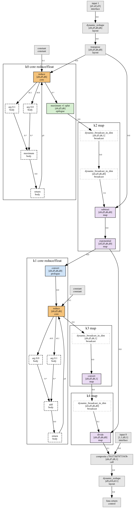
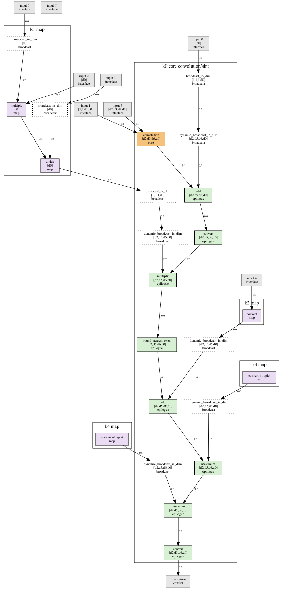

# `kernels`

1. **Purpose.** Cuts every normalized component into *kernels*: convex units with at most one core (a
   contraction, a reduction or a scatter-reduce) and the element-wise ops fused around it, or *map
   kernels* of element-wise ops alone. Every other op is a boundary (layout, data movement, size
   computation, constants, composite calls, the interface). Kernels are the unit of `kernel_classes`,
   which groups equal kernels across all models. Each partition comes with a topological order of its
   quotient graph, and each kernel is also written as a graph of its own. Position:
   `normalize → kernels → kernel_classes`.

2. **Background.** Design §4.5; the normalized components in docs/passes/normalize.md; the op-semantics
   table in docs/framework/ir.md.
   - **Convexity.** A vertex set S of a DAG is convex iff no path between two vertices of S leaves S.
     A unit that runs atomically (all inputs ready at its start, outputs available at its end) can be
     scheduled iff it is convex: a path S → w → S would make w wait for S and S wait for w. This is the
     condition of instruction-set-extension identification ("We call the cut S convex if there exists no
     path from a node u ∈ S to another node v ∈ S that involves a node w ∉ S": Pozzi, Atasu, Ienne,
     "Exact and approximate algorithms for the extension of embedded processor instruction sets", IEEE
     TCAD 25(7):1209-1229, 2006, DOI 10.1109/TCAD.2005.855950, Sec. IV; first stated in Atasu, Pozzi,
     Ienne, DAC 2003, DOI 10.1145/775832.775897). Testing one set is linear in the graph.
   - **Convex parts do not make an acyclic partition.** With edges `x1 → y1`, `x2 → y2` and parts
     `{x1, y2}`, `{y1, x2}`, each part is convex (no path joins its two vertices), but the first part
     must run before the second (`x1 → y1`) and after it (`x2 → y2`). The partition is executable iff its
     quotient graph (one node per part, an edge where data crosses) is acyclic, which is checked on its
     own.
   - **Producer-consumer fusion.** Fusing element-wise producers and consumers around one expensive op is
     the shape of XLA's instruction fusion, which also refuses a fusion that would create a cycle
     (`MultiOutputFusionCreatesCycle` in `xla/service/instruction_fusion.cc`, openxla/xla; Snider and
     Liang, "Operator Fusion in XLA: Analysis and Evaluation", arXiv 2301.13062, 2023). Here the rules
     are structural (op classes, shapes, convexity), not a cost model.
   - **One core per kernel** keeps every kernel a single iteration space with one accumulation, which is
     what `iteration_space` classifies (contraction, reduction, map). Softmax and the norms therefore
     split into several kernels, one per reduction.
   - **Shapes are dimension classes.** A component's dims are class variables, equal when the StableHLO
     spec forces them equal (docs/passes/components.md §4.3). Two dims with the same class are equal in
     every instance, so a partition decided on classes is valid for all instances at once; dims that
     happen to coincide in some instances (a square Dense) are not used.
   - Translation validation (Pnueli, Siegel, Singerman 1998; Necula 2000): the partition is the
     certificate; an independent checker re-verifies it without the partition code.

3. **Inputs and outputs.** Input: `build/.normalize/out/normalize/components/<id>.postcard`
   (`NormalizedComponent`) and its summary. Outputs (`build/.kernels/out/kernels/`; schemas
   `docs/schemas/kernels_*`):
   - `components/<id>.json` (`KernelPartition`): `kernels`, `boundaries`, `order`, `evictions`. A
     kernel has its id `k<i>` (kernels with a core first, in the SSA order of their cores, then map
     kernels in the order of their first member), its `core` node, its `domain` (the dims of the core's
     first result, or of every map member), its `members` (node and role, ascending), and its `inputs` and
     `outputs`: every edge end that crosses its border (`src`, `dst`, `end`). A boundary has its node,
     its kind (`interface`, `call`, `control`, `layout`, `data_movement`, `size`, `constant`,
     `irregular`) and, for a node of a boundary op's regions, its `owner`. `order` lists every part
     (`kernel` index or `boundary` node) once, in a topological order of the quotient graph.
   - `kernels/<id>.postcard` (`KernelGraphs`): per kernel a graph of `member` nodes (the normalized
     node's label, its role and `origin`), one `input` node per outside value read (`src`, `res`, type)
     and one `output` node per member result used outside. Edges between members keep their ends; an
     edge from an input keeps the member's port and uses result 0; an edge to an output keeps the result
     and uses port 0. This is what `kernel_classes` hashes and matches.
   - `kernels/<id>.postcard.summary.json` (`PartitionSummary`): kernels with and without a core, cores
     per `<op>/<family>`, members per role, boundary nodes per kind, map kernels that read a composite
     call's result, map kernels of rank at most 1, evictions, instances per model.
   - `summary.json` (`KernelsSummary`): the same over all components, with kernels per component and
     the cores weighted by instances.
   - `views/<id>.dot` (kernels as clusters, coloured by role; boundaries grey) and `views/kernels.md`.

4. **Algorithm** (`algo/`), per component in parallel.
   1. *Units* (`algo/units.rs`). An op that owns regions (`reduce`, `reduce_window`, `scatter`, `sort`)
      forms one unit with its region nodes: the nodes reachable from its region arguments or reaching
      its terminators, without passing the owner, minus every node with a consumer outside (a value
      captured from the enclosing scope stays outside). The `region` and `yield` edges then lie inside
      units and the unit graph is a DAG. Units are numbered by Kahn's algorithm taking the smallest
      node id first: node ids order definitions before uses, so this is SSA order. Each unit's class
      comes from its representative's op-table entry: `core` → core; `elementwise`; `layout` → a
      `broadcast_in_dim` or `dynamic_broadcast_in_dim` may be absorbed, every other layout op is a
      boundary; `data_movement` → boundary, except a `scatter` whose terminator yields a value computed
      by an op (an arithmetic update: a scatter-reduce), which is a core; `size`, `control`,
      `irregular`, `constant`, composite calls and interface nodes → boundaries.
   2. *Ancestors.* One bitset per unit, in unit order: `anc(v) = ∪ (anc(p) ∪ {p})` over predecessors.
      A set S stays convex when a set C is added iff no unit x outside S ∪ C is in
      `anc(S ∪ C)` and has an ancestor in `S ∪ C`; the test walks the bits of `anc(S ∪ C) \ (S ∪ C)`.
   3. *Seeds.* One kernel per core unit, in unit order.
   4. *Epilogues*, kernel by kernel in seed order, to a fixpoint. For a member m, its consumers outside
      the kernel, C, are absorbed together or not at all: every v ∈ C must be a free element-wise unit
      whose result dims equal one of the core's results' dims (K4); every unit in the kernel or in C that
      v reads must have all its consumers in the kernel or in C (K3); and the kernel with C must be
      convex (K2). If the test fails, m is closed: it is an output of the kernel. Operands from outside
      are allowed as long as convexity holds. Element-wise operands have the result's shape, so they are
      the core result's domain (a residual add) or broadcasts. Ties: an op reachable from two cores
      joins the earlier one in SSA order, because the earlier kernel grows first.
   5. *Prologues*, per kernel, walking the core's producers in reverse unit order (consumers are decided
      before their producers): a free element-wise unit joins as a prologue if all its consumers are the
      core or prologue members, they lead to exactly one core operand port, and its result has that
      operand's dims. Its consumers are all inside, so convexity holds.
   6. *Map kernels*: every element-wise unit still free seeds one, in unit order. It grows forward by
      whole consumer sets under the epilogue's rules with the seed's dims as the domain, and backward by
      free element-wise producers with the domain's dims whose consumers are all members, to a fixpoint.
   7. *Broadcasts*, in reverse unit order: a free broadcast whose consumers are all in one kernel and
      whose operand is outside it joins it with role `broadcast`. Reverse order absorbs a chain
      (`broadcast_in_dim` then `dynamic_broadcast_in_dim`) whole. A broadcast that feeds two kernels, or
      the boundaries, is a layout boundary.
   8. *Quotient.* Kahn's algorithm over the parts (kernels and boundary units). If a cycle remains, the
      latest kernel on it with more than its seed is banned from its most recently added member, and the
      partition is recomputed from step 3 with the ban. Every round adds a new ban, so the loop ends.
      At `full` no component needs one.
   9. *Write* the partition, the kernel graphs (`algo/extract.rs`), the summaries and the views.

   Complexity: the bitsets cost O(U²/64) memory and O(U·E/64) time for U units and E unit edges; a
   convexity test is O(U/64 · |anc|); the largest component (2.3 k nodes) takes milliseconds. The model
   set at `full` partitions in about 1 s with 78 MB peak RSS.

   Examples, from the model set at `full` (the views of these components):

   - **Softmax** (yolo11's `DFL`, `cc1623e29123abec0`): the max and the sum are two reduction kernels;
     `x - max` and `exp` form a map kernel, because `exp` feeds both the sum and the division, so it
     cannot be the sum's prologue (K3); the division is a map kernel of its own, because joining it to
     the `exp` kernel would put a path `exp → sum → broadcast → divide` outside the kernel (K2). JAX's
     `max(m, -inf)` guard is the max kernel's epilogue, and the f32 `convert` before the sum is its
     prologue.

      (source: [kernels-softmax.dot](figures/kernels-softmax.dot))

   - **Requantization** (mobilenetv4's full-integer `QConv`, `cf52289c029b85337`, 122 instances): the
     int8 convolution's epilogue holds the whole requantization chain, `+ bias (i32) → convert f32 →
     × (s_x s_w / s_y) → round → + zero point → max → min → convert i8`, with the broadcasts of the bias,
     scale and zero point. The per-channel scale `s_x s_w / s_y` is computed on rank-1 parameters before
     its broadcast, so it is a map kernel of its own (a lower-rank kernel), and so are the conversions of
     the scalar parameters.

      (source: [kernels-requant.dot](figures/kernels-requant.dot))

   - Attention (e.g. sam2's `Attention`): `Q Kᵀ` with its scale as epilogue, the max and the sum, the
     `x - max, exp` map kernel, and `P V` with the division by the sum as its prologue (the division's
     only consumer is the second GEMM's operand).

   Model set at `full` (712 components, 2026-11-01): 4 956 kernels, 1 289 with a core and 3 667 map
   kernels (2 048 of them of rank at most 1: parameter arithmetic such as scale products; 506 read a
   composite call's result: an activation in the parent module of its GEMM). 143 components have no
   kernel (wrappers of calls and layout).

   | core | kernels | kernels × instances |
   |---|---:|---:|
   | `reduce/float` | 308 | 14 989 |
   | `dot_general/float` | 232 | 10 364 |
   | `dot_general/sint` | 292 | 3 834 |
   | `reduce/bool` | 148 | 1 276 |
   | `convolution/sint` | 43 | 820 |
   | `scatter/sint` | 178 | 751 |
   | `reduce/sint` | 23 | 294 |
   | `convolution/float` | 18 | 281 |
   | `dynamic_reduce_window/sint` | 5 | 249 |
   | `scatter/float` | 28 | 161 |
   | `reduce_window/float` | 4 | 134 |
   | `dynamic_reduce_window/float` | 1 | 64 |
   | `reduce_window/sint` | 9 | 12 |

   Kernels per component: 0: 143, 1: 125, 2: 90, 3: 77, 4: 75, 5–9: 118, 10–49: 66, 50 and more: 18 (at
   most 253, ptv3's sparse `SubMConv3d` with its scatters).

5. **Config** (`[passes.kernels]`): `views = true` (write `views/kernels.md` and one DOT file per
   component). Resources: `threads = 8`, `memory_gb = 2`, `timeout_min = 30`. Ties are broken by SSA
   order only; there is no other strategy.

6. **Verification** (`verify.rs`; it reads the normalized components and the written files and never
   calls the partition code: it works on the node graph without unit contraction or bitsets, with
   breadth-first searches and its own reading of the op table). Per component, `<id>:<check>`:
   - `partition`: every node is in exactly one kernel or is a boundary node; every `region` and `yield`
     edge lies inside one part; region arguments are with their owner.
   - `classes`: every member's role fits its op class (core: a core op or an arithmetic scatter;
     prologue, epilogue, map: element-wise; broadcast: `broadcast_in_dim`); every boundary kind is its
     node's class; no core or element-wise node is a boundary.
   - `k1`: at most one core per kernel, `core` names it, and only kernels with a core have prologues
     and epilogues.
   - `k2`: a forward search from each kernel's outside successors, through outside nodes only, never
     reaches the kernel.
   - `k3`: a member whose value is consumed inside the kernel has every consumer inside.
   - `k4`: the domain is the core's result dims; epilogue members are over a core result's dims and
     descend from the core inside the kernel; prologue members reach exactly one core operand port
     through prologue and broadcast members and have that operand's dims; map members are over the
     domain; broadcasts read outside values (or other broadcasts) and feed members only.
   - `quotient`: Kahn's algorithm finds the quotient graph acyclic, and the stored order lists every
     part once with every crossing edge going forward.
   - `reconstruct`: the recorded crossings are exactly the graph's; the kernel graphs (member labels,
     inputs, outputs and their edges), the crossings into boundaries and the edges between boundaries
     rebuild the normalized graph's edge ends exactly, and every member's label equals its node's.

   Once: `complete` (every normalized component has a partition and kernel graphs). Every check has a
   negative test in `tests/smoke/kernels.rs` (a node placed twice, an edited crossing, a missing
   partition, a non-convex kernel, two cores, an escaping intermediate, a misaligned epilogue, the
   cyclic-quotient example above, a layout op as a member, a dropped edge in a kernel graph). A property
   test partitions random graphs of element-wise ops, GEMMs, reductions, broadcasts and transposes and
   requires every check to pass and the partition to be deterministic.

7. **Resources.** Linear in the component's size apart from the bitsets (U²/64 words per component,
   about 80 KB for the largest). Run and verification at `full`: about 1 s for the pass, 78 MB peak RSS;
   outputs 34 MB, most of it the DOT views (2026-11-01).

8. **Limitations.**
   - Kernels do not cross component borders: a composite call is a boundary, so an activation applied in
     the parent module of its GEMM (`gelu(Dense(x))`) is a map kernel of the parent (506 map kernels at
     `full`). Components stay compositions of kernels; fusing across them would need the expanded graph.
   - K3 allows no intermediate to escape: if a core's result also feeds a layout op or the output, the
     core has no epilogue (one output per value; no duplication of producers).
   - Lower-rank parameter arithmetic (scale products, conversions of scalar parameters) forms its own
     small map kernels instead of being sunk below its broadcast into the consumer kernel.
   - Layout ops other than broadcasts are boundaries, so element-wise chains broken by a reshape or a
     transpose are separate map kernels.
   - `sort` and `fft` are boundaries (`irregular`): they are outside the kernel classes and the units.
   - Region bodies are recognized structurally (reachability from region arguments and to terminators);
     a value computed outside and used only inside a region joins the region.
